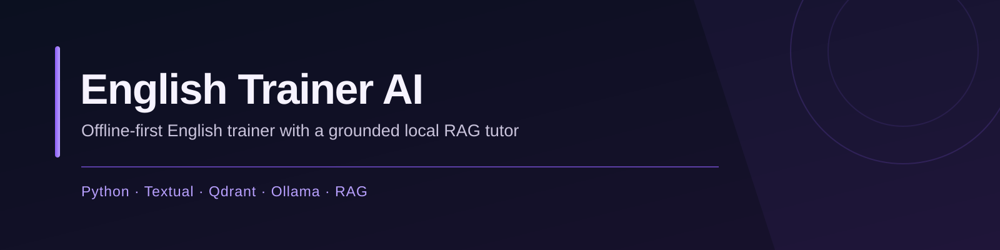
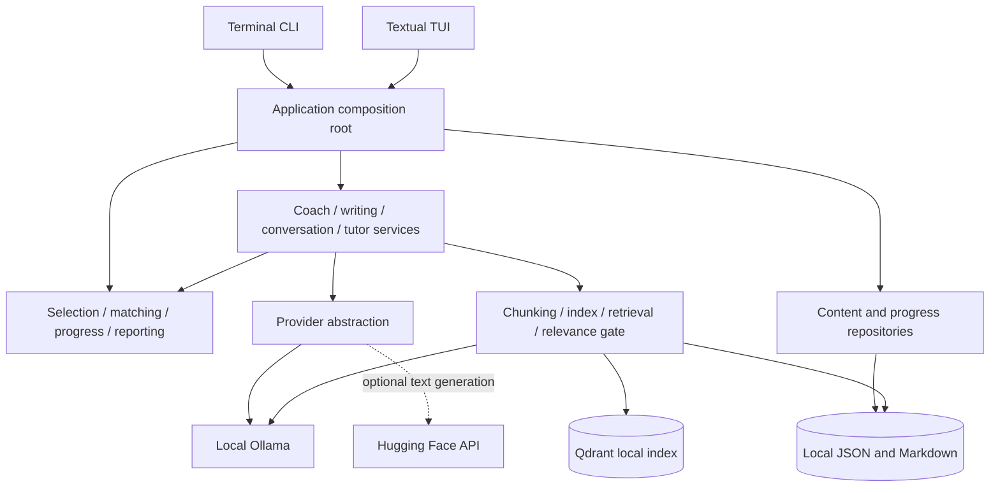
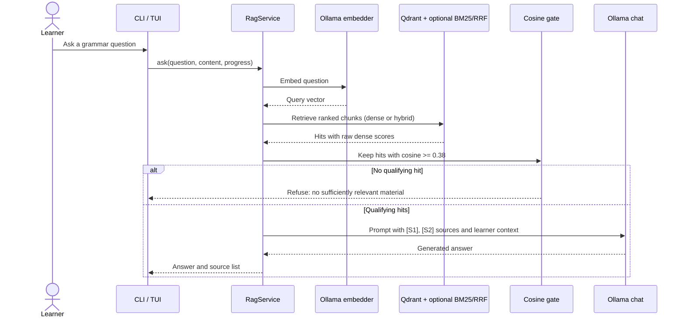

<p align="center">
  
</p>

<p align="center">
  
  
  
  
  <a href="https://github.com/YasminMi/english-trainer-ai/actions/workflows/ci.yml"></a>
  <a href="LICENSE"></a>
</p>

English Trainer AI turns local English notes into daily practice. Drills, flashcards, review scheduling, and progress tracking work without an AI service. A Textual interface and a terminal CLI share the same application layer. When Ollama is available, Miu can hold a conversation or retrieve local study material to answer a question with source references.

<p align="center">
  
</p>

<p align="center">
  
  
</p>

More screens: [flashcards](docs/images/flashcards-menu.svg) · [conversation](docs/images/conversation-demo.svg).

## Contents

- [The problem and the app](#the-problem-and-the-app)
- [Engineering principles](#engineering-principles)
- [Architecture](#architecture)
- [Retrieval evaluation](#retrieval-evaluation)
- [Engineering decisions](#engineering-decisions)
- [Quality](#quality)
- [Running locally](#running-locally)
- [Configuration and AI providers](#configuration-and-ai-providers)
- [Limitations and trade-offs](#limitations-and-trade-offs)
- [Roadmap](#roadmap)
- [License](#license)

## The problem and the app

Scattered study notes are easy to collect and hard to review consistently. This app makes those notes usable in short practice sessions, tracks what is due, and offers a local tutor that searches the same material before answering.

| Study flow | What it does | Where in the code |
|---|---|---|
| Practice | `to be` drills, sentence translation, flashcards, and dictation; weighted item selection | [CLI practice](src/english_trainer/interfaces/cli/practice.py), [selection](src/english_trainer/domain/selection.py), [TUI practice](src/english_trainer/interfaces/tui/screens/practice.py) |
| Review and progress | Due reviews, daily goals, streaks, weekly reports, and JSON/CSV exports | [progress](src/english_trainer/domain/progress.py), [reporting](src/english_trainer/domain/reporting.py), [CLI tools](src/english_trainer/interfaces/cli/tools.py) |
| Learner content | Merge versioned JSON, local entries, and Markdown notes; add entries from the CLI | [content repository](src/english_trainer/storage/content.py), [Markdown loader](src/english_trainer/storage/markdown_notes.py), [CLI tools](src/english_trainer/interfaces/cli/tools.py) |
| AI practice | Sentence generation, translation feedback, free writing, and multi-turn conversation when a provider is available | [coach](src/english_trainer/services/coach.py), [writing](src/english_trainer/services/writing.py), [conversation](src/english_trainer/services/conversation.py) |
| Grounded tutor | Retrieve study chunks, reject low-scoring results, ask Ollama to answer with citations, and return a source list | [RAG service](src/english_trainer/rag/service.py), [prompts](src/english_trainer/rag/prompts.py) |

## Engineering principles

| Principle | How it is guaranteed |
|---|---|
| Offline-first core | Practice and progress use local content and domain functions; RAG is constructed lazily in [`app.py`](src/english_trainer/app.py). [Offline integration tests](tests/integration/test_rag_offline.py) cover use without a provider. |
| Ground tutor answers in study material | [`RagService`](src/english_trainer/rag/service.py) refuses when no hit passes the raw dense-cosine gate; [`prompts.py`](src/english_trainer/rag/prompts.py) instructs the model to use supplied sources and cite them; [service tests](tests/unit/rag/test_service.py) cover refusal. The generated text is not independently fact-checked. |
| Share one application layer | [`app.py`](src/english_trainer/app.py) builds services and repositories used by the [CLI](src/english_trainer/interfaces/cli) and [TUI](src/english_trainer/interfaces/tui). |
| Make provider failures explicit | [Provider contracts](src/english_trainer/llm/base.py) define typed errors; [Ollama](src/english_trainer/llm/ollama.py) and [Hugging Face](src/english_trainer/llm/huggingface.py) translate failures; [integration tests](tests/integration/test_provider_failures.py) cover unavailable services. |
| Validate curated content | [Schema](src/english_trainer/storage/content_schema.py) requires version 1, typed fields, unique IDs, and valid exercise answers; [repository](src/english_trainer/storage/content.py) validates on load. |
| Keep local writes atomic | [JSON store](src/english_trainer/storage/json_store.py) syncs a sibling temporary file before replacement; [tests](tests/unit/storage/test_json_store.py) exercise persistence. |

## Architecture



The tutor indexes Markdown sections and selected JSON rules and examples. A corpus fingerprint avoids re-embedding unchanged material; learner progress is added to the prompt rather than the vector index. See [chunking](src/english_trainer/rag/chunking.py) and [indexing](src/english_trainer/rag/index.py).



## Retrieval evaluation

The [gold set](evals/rag_golden.jsonl) has **65 questions**: 44 answerable, 16 off-topic, and 5 about unsupported grammar. The original 55 cases were used to choose the gate; 10 later cases are tagged `held-out`. The current run indexed **57 chunks** with local Ollama `embeddinggemma` and evaluated both modes at **k = 5**. See the [evaluation notes](evals/README.md) for case labels, score diagnosis, and partition results.

| Metric | Meaning |
|---|---|
| hit@5 / recall@5 | Share of answerable questions with any relevant chunk in the first five / mean share of all relevant labels retrieved |
| MRR | Mean reciprocal rank of the first relevant chunk |
| False accept / false reject | Share of unanswerable questions admitted / answerable questions refused by the gate |

| Retrieval | Gate | hit@1 | hit@5 | recall@5 | MRR | False accept | False reject |
|---|---:|---:|---:|---:|---:|---:|---:|
| Dense | .20 | .659 | .886 | .841 | .763 | .952 | .000 |
| Dense **(default)** | **.38** | **.659** | **.886** | **.841** | **.763** | **.238** | **.045** |
| Hybrid BM25 + RRF | .20 | .705 | .909 | .886 | .789 | .857 | .000 |
| Hybrid BM25 + RRF | **.38** | .705 | .909 | .886 | .789 | .238 | .068 |

These numbers come from fresh `english-trainer eval-rag --retrieval dense|hybrid --json` runs, with `RAG_MIN_SCORE=0.20` for the comparison rows. This harness measures retrieval and gate decisions, not generated answer quality. The gate changes admission, not retrieval ranking. At `.38`, hybrid retrieves more relevant chunks but rejects more answerable questions; dense remains the application default. On the 10 held-out questions at `.38`, hybrid hit@5 was **1.000** versus dense **.750**, but hybrid false reject was **.250** versus dense **.000**. The gate uses raw dense cosine, not lexical or fused ranking scores.

## Engineering decisions

| ID | Decision | Why | Where |
|---|---|---|---|
| D1 | Keep offline study flows separate from AI services | Core practice remains usable when Ollama is down | [Application](src/english_trainer/app.py), [domain](src/english_trainer/domain) |
| D2 | Default to dense retrieval; keep hybrid selectable | Hybrid improves ranking on this set but raises false rejects at the current gate | [Config](src/english_trainer/config.py), [retrieval](src/english_trainer/rag/retrieval.py), [evaluation](evals/README.md) |
| D3 | Implement BM25 and reciprocal rank fusion in Python | Compare dense and hybrid on the same local corpus without a second search service | [Retrieval](src/english_trainer/rag/retrieval.py) |
| D4 | Gate on one calibrated raw cosine threshold, `.38` | The former `.20` threshold admitted most unanswerable cases; boosted and fused scores are unsuitable for the gate | [Relevance](src/english_trainer/rag/relevance.py), [evaluation](evals/README.md) |
| D5 | Translate provider failures into typed errors | An outage must not look like an evaluated answer | [Contracts](src/english_trainer/llm/base.py), [Ollama](src/english_trainer/llm/ollama.py), [tests](tests/integration/test_provider_failures.py) |
| D6 | Validate versioned content before merging it | Reject malformed records and duplicate IDs with a path to the error | [Schema](src/english_trainer/storage/content_schema.py), [repository](src/english_trainer/storage/content.py) |
| D7 | Use atomic JSON replacement for local state | Avoid a partly written progress or content file after an interrupted write | [JSON store](src/english_trainer/storage/json_store.py) |
| D8 | Type-check the source tree with strict mypy | Catch contract and nullability mistakes across layers | [`pyproject.toml`](pyproject.toml), [`Makefile`](Makefile) |

## Quality

Install development tools, then run the complete local gate:

```bash
python -m pip install -e ".[all]" --group dev
make check
```

`make check` runs Ruff lint and format checks, strict mypy, content validation, and pytest. The suite is divided into [unit tests](tests/unit) for domain, storage, services, providers, and RAG logic, and [integration tests](tests/integration) for CLI/TUI, local Qdrant, offline behavior, and provider failures. The current `python -m pytest -q` run passed **166 tests**.

[CI](.github/workflows/ci.yml) runs on **Ubuntu, Windows, and macOS**, each with **Python 3.11**. It installs the `all` and `dev` dependencies, checks compilation and imports, then runs pytest. Ruff, mypy, and content validation are local `make check` targets; they are not CI steps in the current workflow.

## Running locally

Python **3.11 or newer** is required. From a checkout:

```bash
git clone https://github.com/YasminMi/english-trainer-ai.git
cd english-trainer-ai
python -m venv .venv
# Linux/macOS: source .venv/bin/activate
# Windows PowerShell: .\.venv\Scripts\Activate.ps1
python -m pip install -e .
english-trainer          # Textual TUI
english-trainer cli      # terminal CLI; --cli also works
```

No model or `.env` file is needed for drills, flashcards, review, and progress. Optional extras: `python -m pip install -e ".[audio]"` for Edge TTS and pygame, or `python -m pip install -e ".[huggingface]"` for the Hugging Face fallback. Audio generation needs network access and playback support. The dictionary uses a local map first, then an online lookup for unknown words.

To validate content or reproduce retrieval results:

```bash
english-trainer validate-content
english-trainer eval-rag --retrieval dense --json
english-trainer eval-rag --retrieval hybrid --json
```

## Configuration and AI providers

For local AI features, run [Ollama](https://ollama.com) and pull the configured models:

```bash
ollama pull llama3.2
ollama pull gemma2:2b
ollama pull embeddinggemma
ollama serve
```

Settings are read from environment variables, including a project-root `.env`. Defaults below are from [`config.py`](src/english_trainer/config.py).

| Variable | Default | Purpose |
|---|---|---|
| `ENGLISH_TRAINER_HOME` | repository root in a checkout; otherwise working directory | Base for `data/` and `notes/` |
| `OLLAMA_URL` | `http://localhost:11434` | Local Ollama endpoint |
| `OLLAMA_MODEL` | `llama3.2` | General generation and conversation |
| `OLLAMA_TIMEOUT_SECONDS` | `120` | Default Ollama client timeout |
| `RAG_MODEL` | `gemma2:2b` | Grounded tutor generation |
| `RAG_EMBED_MODEL` | `embeddinggemma` | Document and question embeddings |
| `RAG_MIN_SCORE` | `0.38` | Minimum raw dense cosine for a tutor answer |
| `RAG_TOP_K` | `2` | Maximum chunks passed to the tutor |
| `RAG_RETRIEVAL` | `dense` | `dense` or `hybrid` |
| `HF_TOKEN`, `HF_MODEL` | empty, `gpt2` | Optional remote text-generation fallback |
| `AI_LOCAL_FALLBACK` | `false` | Limited built-in sentence examples when providers fail |
| `LOG_LEVEL`, `LOG_JSON_FORMAT` | `WARNING`, `false` | Logging settings |

General one-shot text generation tries Ollama, then Hugging Face only when `HF_TOKEN` is set, then limited local examples when enabled. Conversation and the grounded tutor require Ollama. Hugging Face prompts leave the machine; the online dictionary and Edge TTS also use network services. Local state is stored under `data/`, including progress, user content, AI cache, conversations, reports, and the Qdrant index. The shipped [`data/content.json`](data/content.json) remains separate from learner-created entries.

## Limitations and trade-offs

| Area | Current limit |
|---|---|
| Grounding | A related chunk can pass the cosine gate even when the requested grammar rule is absent. The prompt requests citations, but generated claims and citation accuracy are not programmatically verified. |
| Retrieval | The `.38` gate was calibrated on 55 questions; the held-out set contains only 10. Results describe this corpus and embedder, not general language-learning performance. |
| Local storage | JSON state and Qdrant local mode target one user and one process. Concurrent clients need a different deployment model. |
| UI | The TUI has extracted screens, but its application shell remains concentrated in [`interfaces/tui/app.py`](src/english_trainer/interfaces/tui/app.py). |
| Content and devices | Beginner notes need further language review. Initial indexing and generation can be slow on CPU-only machines; audio requires network access and playback support. |

## Roadmap

- [x] Add a Recall@K retrieval evaluation harness.
- [x] Compare dense retrieval with hybrid BM25 + RRF.
- [x] Add provider failure tests.
- [x] Validate versioned content against a schema.
- [x] Calibrate the relevance gate on a labeled set.
- [ ] Split the remaining TUI application shell into smaller modules.
- [ ] Add a gate for questions about grammar absent from the retrieved material.
- [ ] Review more beginner content with a language specialist.

## License

MIT. See [LICENSE](LICENSE).
