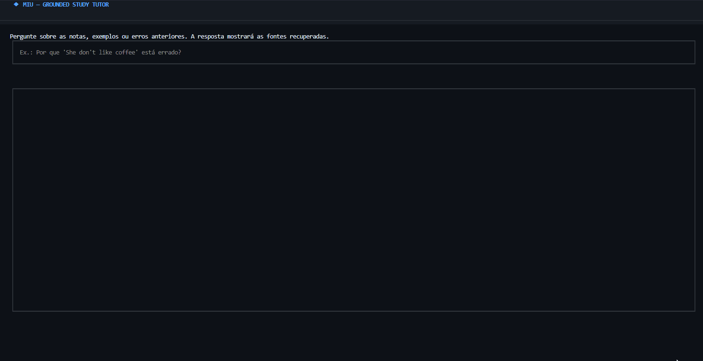
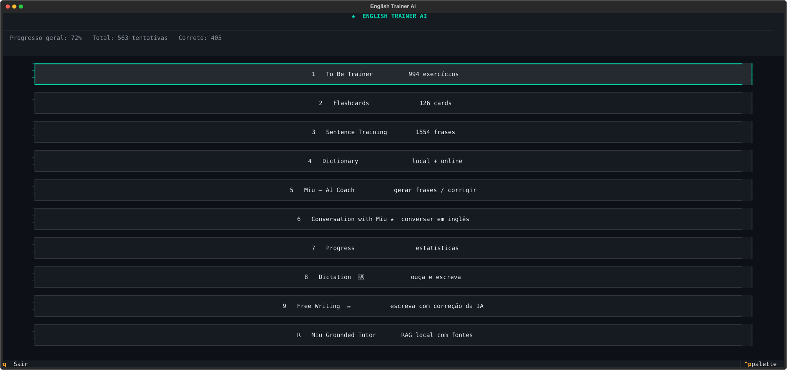
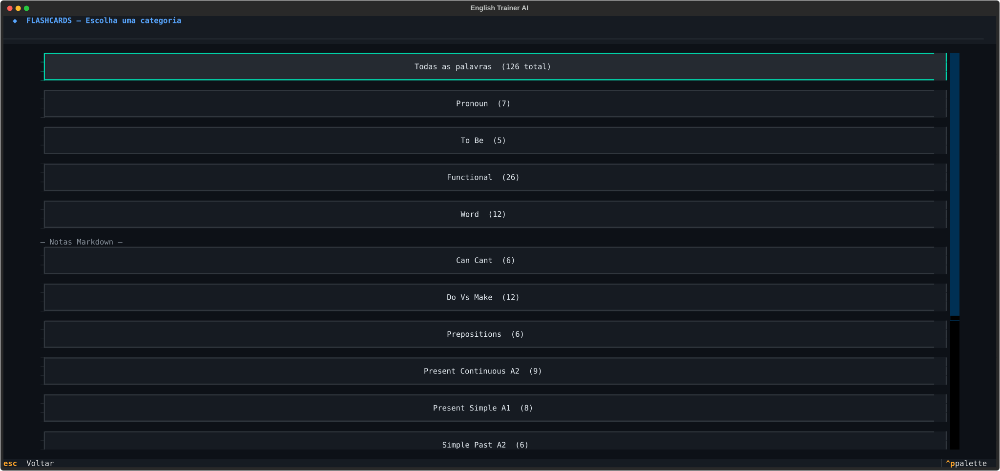
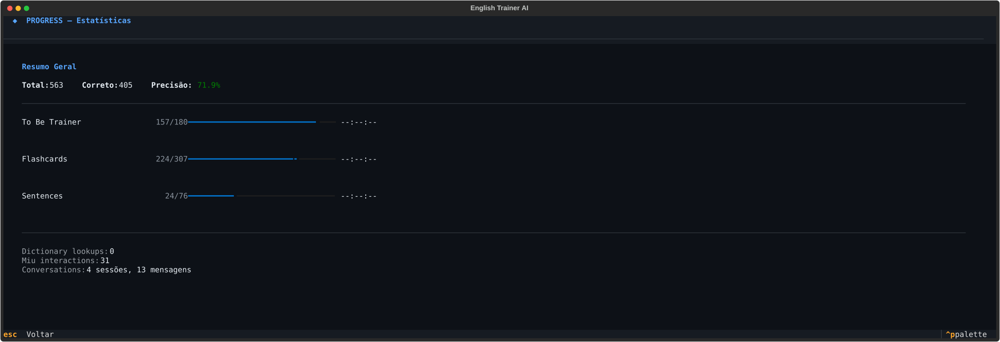
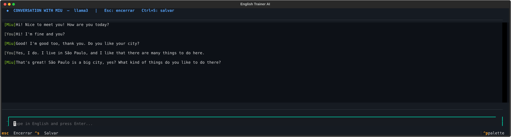

# English Trainer AI

[](https://github.com/YasminMi/english-trainer-ai/actions/workflows/ci.yml)

A local English study app built with Python, with spaced repetition, progress tracking, CLI and TUI interfaces, and a RAG-based tutor.

I started this project because I had a lot of English notes, but I was not reviewing them consistently. The core practice modes work without AI. When Ollama is available, Miu supports conversation practice and answers questions using local study material, with source citations.

## Highlights

- Core study flows work offline, with a CLI and a Textual TUI sharing the same training and progress modules.
- Local RAG tutor (Miu): Qdrant vector store, Ollama embeddings, lexical reranking and cited sources.
- Spaced repetition, progress tracking and weekly reports.
- JSON persistence with atomic writes.
- Automated test suite and CI on Linux, Windows and macOS.

## Demo

### Grounded tutor



### Main interface



### Practice and progress





### Conversation with Miu



## What is implemented

| Area | Features |
|---|---|
| Practice | `to be` drills, sentence translation, flashcards, dictation |
| Review | Weighted item selection, spaced repetition |
| Routine | Daily goal, streak, weekly report |
| Writing | AI feedback on free writing, when a provider is available |
| Conversation | Multi-turn practice and grammar review through Ollama |
| Grounded tutor | Local RAG over notes and curated examples, with citations |
| Content | Versioned JSON and Markdown notes, plus locally stored user entries |
| Interfaces | CLI and Textual TUI |

The CLI adds daily planning, report export and content creation. The TUI focuses on practice, conversation, dictionary, dictation and progress. Both share the same content and progress data.

## Technical decisions

Flashcards, sentence training, SRS and progress tracking never depend on Ollama or Hugging Face. If no AI provider is available, those parts of the app still work.

Ollama handles local generation and conversation. Hugging Face is only used for optional text-generation flows. Conversation currently requires Ollama.

CLI and TUI are two entry points over the same code: same training, matching, progress and provider modules. I didn't want to maintain the logic twice.

The RAG tutor retrieves local material before answering, cites the chunks it used, and says so when nothing scores high enough instead of guessing. A corpus fingerprint avoids reindexing when nothing changed.

Progress, reports, conversations, cache and user-created content are kept separate from the versioned study material and ignored by Git.

For now, JSON is enough because the application is local and designed for one user.

## Project structure

```text
english_trainer/
|-- cli.py           terminal menus and study flows
|-- tui_app.py        Textual screens and interactions
|-- progress.py       metrics, daily goals and SRS state
|-- reporting.py      weekly summaries and JSON/CSV export
|-- data_access.py    atomic JSON persistence and Markdown loading
|-- hf_llm.py         Ollama and Hugging Face integration
|-- rag/              chunking, embeddings, Qdrant retrieval and grounding
|-- rag_cli.py        grounded tutor flow for the terminal
|-- conversation.py   conversation session and grammar review
|-- audio.py          Edge TTS generation and pygame playback
`-- training.py       sentence selection and answer feedback
```

| Category | Technologies |
|---|---|
| Core | Python 3.11, Textual, Requests, python-dotenv |
| AI | Ollama, Hugging Face Hub |
| RAG | Qdrant, `embeddinggemma`, semantic retrieval, lexical reranking |
| Audio | Edge TTS, pygame |
| Quality | pytest, GitHub Actions |

## Miu's grounded tutor architecture

Miu indexes Markdown sections, unique grammar explanations and representative JSON examples. User progress is added as structured context instead of being stored in the vector database.

```text
Markdown notes + curated JSON examples
   |
chunking + metadata
   |
persistent Qdrant index
   |
question
   |
query embedding
   |
semantic search
   |
lexical reranking
   |
minimum-score filtering
   |
retrieved context + weak items
   |
local Ollama generation
   |
answer + source citations
```

The vector index is rebuilt only when the corpus or embedding model changes. Retrieval applies a minimum relevance score, and generation is instructed to use only the returned sources.

## Running locally

```bash
git clone https://github.com/YasminMi/english-trainer-ai.git
cd english-trainer-ai
python -m venv .venv

# Linux/macOS: source .venv/bin/activate
# Windows:     .\.venv\Scripts\Activate.ps1

pip install -r requirements.txt
python main.py          # Textual TUI
python main.py --cli    # terminal interface
```

Practice modes work without a `.env` file. Copy `.env.example` to `.env` only to change an AI provider setting.

## AI providers

Ollama is used by default:

```bash
ollama pull llama3.2
ollama pull gemma2:2b
ollama pull embeddinggemma
ollama serve
```

| Variable | Default | Used for |
|---|---|---|
| `OLLAMA_URL` | `http://localhost:11434` | Ollama endpoint |
| `OLLAMA_MODEL` | `llama3.2` | generation and conversation |
| `RAG_MODEL` | `gemma2:2b` | grounded tutor generation |
| `RAG_EMBED_MODEL` | `embeddinggemma` | local document and query embeddings |
| `RAG_MIN_SCORE` | `0.20` | minimum semantic retrieval score |
| `HF_TOKEN` | empty | optional text-generation fallback |
| `HF_MODEL` | `gpt2` | Hugging Face model |
| `AI_LOCAL_FALLBACK` | `0` | limited `to be` sentence examples |

When no provider responds, evaluation features report that no evaluation was performed.

Prompts sent to Hugging Face leave the local machine. Dictionary searches use `dictionaryapi.dev`, and dictation sends text to Edge TTS. Avoid submitting private information through these integrations.

## Local data

Runtime data lives under `data/`: `progress.json` (attempts, goals, SRS state), `user_content.json` (CLI-created entries), `ai_cache.json` (cached generations), `conversations/` (saved sessions), `reports/` (exports) and `rag_index/` (local Qdrant collection and manifest). These paths and interrupted-write temp files are ignored by Git.

## Tests and CI

```bash
pip install -r requirements-dev.txt
python -m pytest -q
```

Tests cover answer normalization, training hints, SRS, daily progress, reports, data persistence, Markdown loading, local content separation, RAG chunking, embedding failures, reranking, grounded prompt construction and unavailable-provider behavior.

GitHub Actions runs compileall, an import check and the test suite on Python 3.11 across Linux, Windows and macOS.

## Limitations and trade-offs

JSON persistence is designed for one local process, not concurrent users. AI responses are model-dependent and are not treated as authoritative corrections. Audio needs network access and a working playback device.

The TUI is still concentrated in one module, which is the clearest candidate for a future split. The beginner content set still benefits from continued manual language review. Initial RAG indexing and local generation can be slow on CPU-only machines, and Qdrant's local mode is meant for one process; a server deployment would be needed for concurrent clients.

## Roadmap

- Evaluate retrieval quality with Recall@K.
- Compare dense retrieval with a hybrid dense/sparse search.
- Add integration tests for provider failures.
- Validate versioned content against a schema.

## License

MIT. See [LICENSE](LICENSE).
